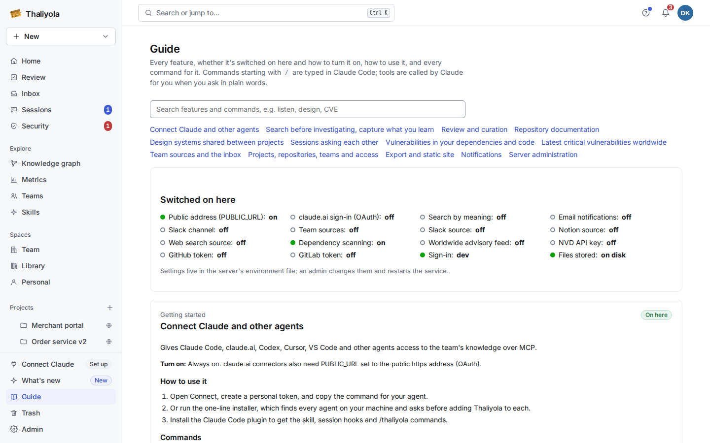
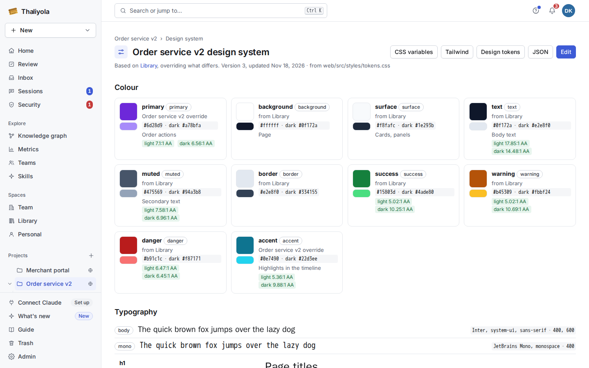
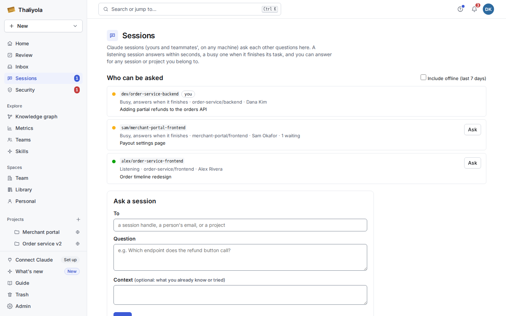
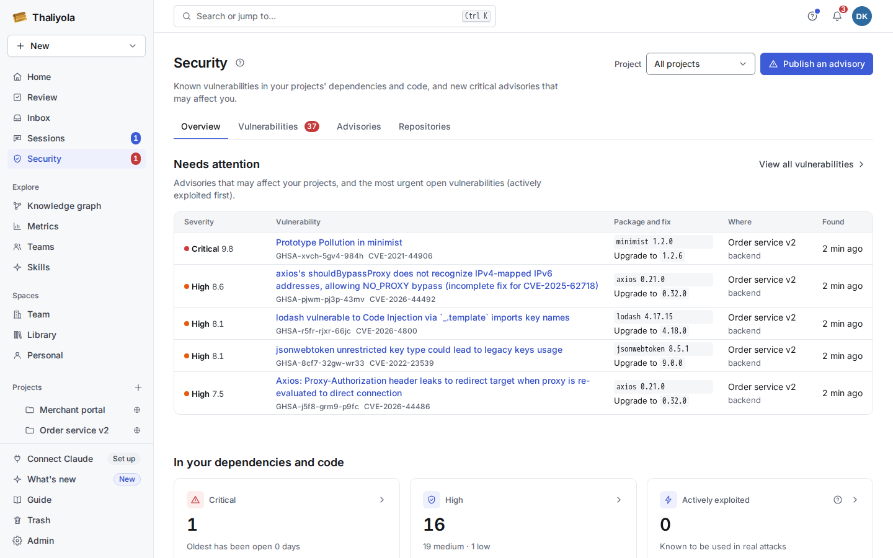

# Thaliyola documentation

The [main README](../README.md) covers everything in one place. These guides go deeper on one subject each. In the app, **Guide** (`#/guide`) shows every feature, whether it's switched on in your installation, how to use it and every command.

| Guide | Read it to |
|---|---|
| [Installing and upgrading](install.md) | Install with Docker, natively or on Kubernetes; the UTF-8 database requirement and converting an existing database; how migrations run |
| [Design systems](design-systems.md) | Share colours, fonts and design rules between projects with *based on*; capture a design from code; export it as CSS, Tailwind or design tokens |
| [Sessions asking each other](sessions.md) | Ask another Claude session with `/thaliyola:ask`; make one answer with `/thaliyola:listen`; `/thaliyola:busy`; how a question travels |
| [Acceptance testing](acceptance.md) | Check a deployed server: the tool sweep and real Claude sessions as team members |
| [Ops notes for 1.1](ops-1.1.md) | Build arguments, CI variables and the ops checklist for 1.1 |
| [Agent integrations](../integrations/README.md) | The Claude Code plugin (skill, hooks, commands), connect.sh, and other agents |

## Screenshots

| | |
|---|---|
|  |  |
|  |  |
