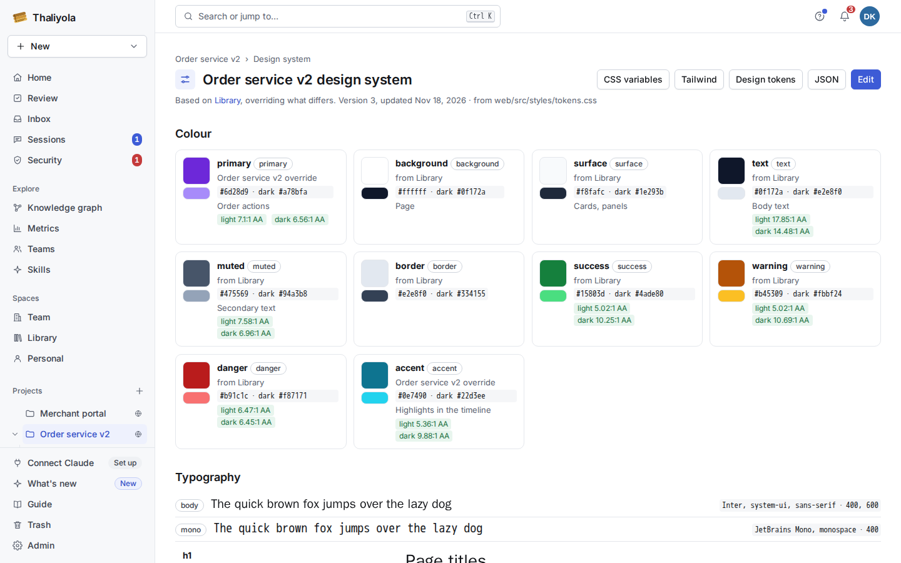

# Design systems: sharing a design between projects

Every project, and the Team and Library spaces, can hold a **design system**: the colours, fonts, spacing and rules its UI is built from, stored as structured tokens. Projects share a design by being **based on** another system, usually the Library's. They inherit everything from it and override only what differs.



## How a project gets a design

There are three ways, and they combine:

| Way | When to use it | How |
|---|---|---|
| Capture it from the code | The app already exists | In Claude Code, open the app's repository and run `/mcp__thaliyola__capture-design`. Claude reads CSS variables, the Tailwind config, theme files, fonts and the shared components folder, then records them with `update_design_system`. It takes every value from the code and invents none. |
| Base it on a shared system | The app should look like the rest of the product | Project page → **Design** → **Edit** → *Based on* → pick the Library (or another project) → **Save**. Or ask an agent: `update_design_system` with `based_on: "library"`. |
| Write it by hand | A new design, or small changes | Project page → **Design** → **Edit**, then edit the tokens JSON and the rules. |

Run `/mcp__thaliyola__capture-design library` to capture an app as an override of the Library's system: Claude records only the values that differ.

## How "based on" works

A system can point at one other system through its `based_on`. That one can point at another, up to 5 levels deep:

```
Library ("Core")            colours: primary #2563eb, text, background, …   fonts: Inter
   ▲ based on
Order service                colours: primary #7c3aed (override), + OrderStatusBadge component
   ▲ based on
Order service – kiosk        colours: background #000000 (override)
```

The **effective** design of a project is built from the farthest base inwards. Each nearer system overrides the one behind it:

| Part | How the layers combine |
|---|---|
| Colours, spacing, radii, shadows, breakpoints, components, type scale | Merged **by name**, ignoring case: an entry named `primary` in the project replaces `primary` from the base, keeps its position, and new names are added at the end. Everything else is inherited unchanged. |
| Fonts | Merged **by role** (`body`, `heading`, `mono`, `display`): the project's `body` font replaces the base's `body` font. |
| Icons, voice, accessibility notes | The nearest system that sets them wins. |
| Rules (principles) | All layers are shown, the project's own rules first, then the base's. |
| Design decisions | Decisions tagged `design`, and component, UX pattern, screen and token pages from every layer, are listed together. |

On the Design page, each colour says where it comes from: *from Library* when inherited, *Order service v2 override* when the project replaced it.

What this means in practice:
- **Change the Library, and every project based on it changes**: the next `get_design_system`, export or page view uses the new values. The Library's Design page lists the projects that use it.
- **A project can't delete an inherited entry.** It can only override it by name (e.g. set `muted` to its own value). `remove` in `update_design_system` drops only the project's own entries.
- **No loops:** a system can't be based on itself or on a system that is already based on it.
- **Versions:** every save keeps a version of that system (its own tokens, rules and base), which can be restored from the editor's *History*. Restoring brings back that version's tokens, rules and base system together.

## Who can edit

| System | Who can change it |
|---|---|
| A project's | Anyone whose roles in the project include *Propose*: Contributors, Reviewers, Moderators and Project admins (directly, through a team, or from a project above) |
| Team or Library | Those who review in that space, and Administrators |
| Design decisions | Anyone who can propose in the project; owners' decisions publish at once, others go to Review |

Anyone who can read a project can read its design. A project can only be based on a system the person setting it can read.

## Using the design when building

- `get_project_context` (which coding agents call before changing code) includes a short **design** summary: the palette with roles and dark values, the fonts, the base system and recent design decisions.
- `get_design_system` returns the full effective system, plus contrast checks. Pass `format` to get it ready to paste:

| `format` | You get |
|---|---|
| `css` | `:root { --color-primary: …; --font-body: …; --text-…; --space-…; --radius-…; --shadow-… }` plus a `prefers-color-scheme: dark` block with the dark values |
| `tailwind` | a `theme.extend` with colours (pointing at the CSS variables), fontFamily, fontSize, spacing, borderRadius, boxShadow and screens |
| `w3c` | W3C Design Tokens Community Group JSON (`$value`, `$type`, dark values under `$extensions`) |
| `json` | the effective tokens as stored |

The same exports are buttons on the Design page and at `GET /api/scopes/:slug/design/export?format=…`.

## Checking the code against the design (drift)

The recorded design is only useful while the code still matches it. A **drift check** compares what the code really uses with the project's effective design system and keeps the report:

- **Values that differ:** a colour, spacing, radius, shadow, breakpoint or font the code defines differently (light and dark separately). `4px` and `0.25rem` count as the same, and so does a font stack that still starts from the recorded font.
- **Not on both sides:** tokens recorded but not in the code, and tokens in the code but not recorded. Only the kinds the check looked at are compared.
- **Hard-coded colours:** colours written directly in components and styles instead of a token, each with the token it matches exactly, the one it's probably meant to be (close in colour), or "not in the palette".

Two ways to run it:

| | How |
|---|---|
| In CI, on every merge | The CI templates on Connect (and in [`integrations/ci`](https://github.com/ramith27/thaliyola/tree/main/integrations/ci)) include `curl -fsS <server>/design-drift.mjs -o /tmp/d.mjs && THALIYOLA_URL=<server> node /tmp/d.mjs`. The script has no dependencies: it reads CSS custom properties (light and dark blocks) and finds hex and `rgb()`/`hsl()` colours in source files, then sends them. `--project <slug>` when the repository isn't added to a project, `--dir src,styles` to limit where it looks, `--fail-on-drift` to fail the build. It never fails the build otherwise. Its token needs Contributor in the project. |
| With Claude | `/mcp__thaliyola__check-design` reads the design the same way capture-design does (Tailwind and theme files too), records the report and offers fixes; `check-design yes` replaces hard-coded colours with their tokens after showing the plan. |

The latest report shows as **Code vs design** on the Design page, and `get_project_context` tells coding agents about it ("don't add more hard-coded colours"). API: `POST /api/scopes/:slug/design/drift` (tokens, hardcoded, source, head_sha), `GET /api/scopes/:slug/design/drift`; MCP: `check_design_drift`. The last 20 reports per project are kept.

## Figma

`/mcp__thaliyola__sync-figma-design <figma url> [from-figma|to-figma]` compares a Figma file's variables and styles (colour variables with light and dark modes, text styles, spacing and radius variables, effects) with the project's design system, lists what's the same, different, or only on one side, and after you confirm updates Thaliyola from Figma (`source` set to the Figma URL) or Figma from Thaliyola. It needs the Figma connector in the same Claude client; Thaliyola itself never calls Figma.

## Contrast checks

Text, muted, primary, accent and status colours are checked against the `background` colour (or `surface`) in light mode and, where both have dark values, in dark mode. Anything under WCAG AA's 4.5:1 is flagged on the page and in the result of every `update_design_system`. Only hex and `rgb()` values can be measured; `oklch()`, `hsl()` and `var()` values are skipped.

## Token reference

```json
{
  "colors": [{ "name": "primary", "value": "#2563eb", "dark": "#4f8cff", "role": "primary", "usage": "Links, focus, main action" }],
  "typography": {
    "fonts": [{ "role": "body", "family": "Inter, system-ui, sans-serif", "weights": [400, 600] }],
    "scale": [{ "name": "body", "size": "0.95rem", "line_height": "1.55", "weight": 400, "font": "body", "usage": "Body text" }]
  },
  "spacing":     [{ "name": "4", "value": "16px" }],
  "radii":       [{ "name": "md", "value": "12px", "usage": "Cards" }],
  "shadows":     [{ "name": "lg", "value": "0 10px 40px rgba(15, 23, 42, 0.14)" }],
  "breakpoints": [{ "name": "phone", "value": "860px" }],
  "components":  [{ "name": "Button", "description": "Primary and secondary actions", "path": "src/ui/Button.tsx", "status": "stable" }],
  "icons": "Line icons, 1.5px stroke",
  "voice": "Plain, short sentences",
  "accessibility": "AA contrast for all text"
}
```

- Colour roles: `primary`, `secondary`, `accent`, `background`, `surface`, `text`, `muted`, `border`, `success`, `warning`, `danger`, `info`, `other`.
- Colours: hex, `rgb()`, `hsl()`, `oklch()`, `oklab()`, `lab()`, `lch()`, `color()` or `var(--x)`. Sizes: `16px`, `1rem`, `0.5em`, `%`, `vw`, `vh`, `pt`, `ch`, `clamp()` or `calc()`.

## MCP tools and API

| Tool | Purpose |
|---|---|
| `get_design_system` | The effective system for a project, team or library, optionally exported |
| `update_design_system` | Merge, replace or remove tokens; set rules, `based_on`, `source` and a note |
| `record_design_decision` | A design decision (context, options, choice, consequences) as a decision article tagged `design` |
| prompt `capture-design` | Captures an app's design from its code (optionally `based_on`) |
| `check_design_drift` | Compares the code's tokens and hard-coded colours with the system; keeps the report |
| prompt `check-design` | Runs the drift check from the code, optionally fixing hard-coded colours |
| prompt `sync-figma-design` | Syncs with a Figma file, either way |

API: `GET/PUT /api/scopes/:slug/design`, `GET /api/scopes/:slug/design/export?format=`, `GET /api/scopes/:slug/design/versions`, `POST /api/scopes/:slug/design/restore`, `POST /api/scopes/:slug/design/decisions`, `GET /api/design-systems` (every system you can read, for choosing a base).
